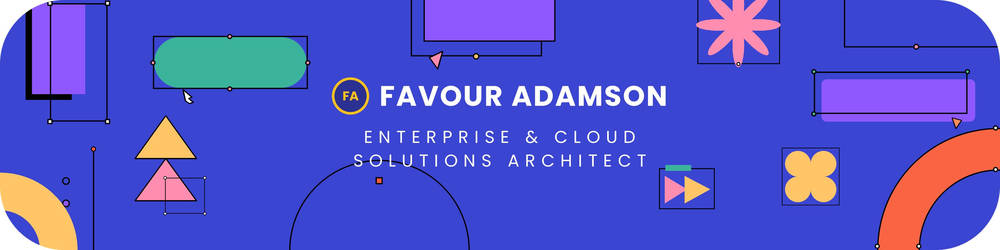
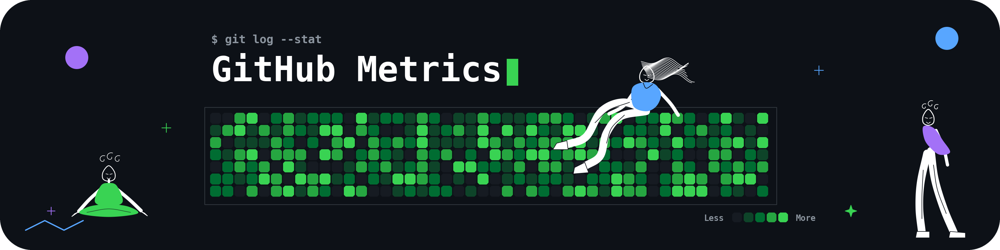
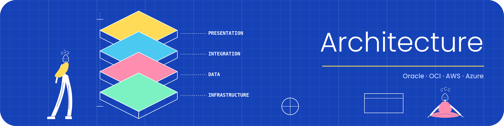
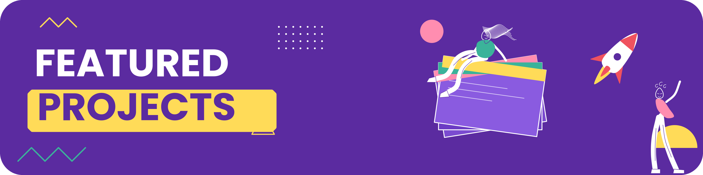
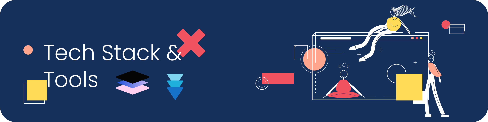
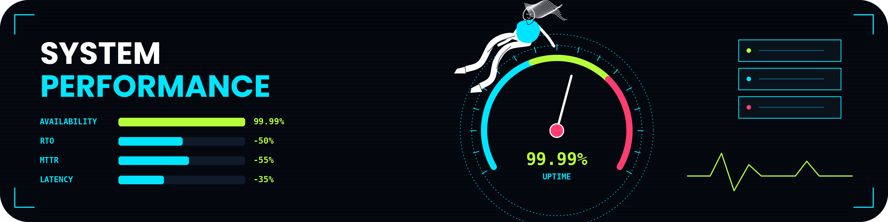

  

<h2 align="center">⚡ F A V O U R &nbsp; A D A M S O N ⚡</h2>

  
  
  
  
  
  
  
  
  
  

  <em><b>Designing Resilient Enterprise Architecture, Multicloud Ecosystems, DevSecOps Pipelines & Advanced Network Infrastructures.</b></em>

  
  
  
  
  
  

---

## 👋 About Me & Core Mission

- **Principal Systems Architect & Engineer** with extensive expertise spanning enterprise architecture, multicloud infrastructure modernization, and resilient network design across global environments.
- **Core Technical Focus**: Specializing in **Enterprise Architecture** (reference architectures, governance, ARBs, and ADRs), **Multicloud Architecture** (AWS, Azure, Google Cloud, and OCI landing zones), **DevSecOps** (Terraform, CI/CD pipelines, automated security gates, and container orchestration), **ERP Systems** (Oracle EBS to Fusion Cloud ERP migrations and enterprise integration fabrics), and **Network Architecture** (BGP, MPLS, SD-WAN, and zero-trust segmentation).
- **Innovation & Delivery**: Passionate about engineering open-source tools, automated compliance validation frameworks, production-ready cloud systems, and comprehensive documentation resources that simplify complex architectural challenges.

---

  

---

### 🏅 Professional Certifications & Credentials

  <!-- Tier 1: Enterprise & Expert Architect Levels -->
  
  
  
  
  

  <!-- Tier 2: Professional & Specialty Tiers -->
  
  
  
  
  
  
  
  
  

  <!-- Tier 3: Associate & Advanced Tiers -->
  
  
  
  

---

  

---

### 📊 GitHub Analytics & Performance

  <table width="100%">
    <tr height="210">
      <td align="center" width="50%" height="210"></td>
      <td align="center" width="50%" height="210"></td>
    </tr>
    <tr height="210">
      <td align="center" width="50%" height="210"></td>
      <td align="center" width="50%" height="210"></td>
    </tr>
  </table>

---

  

---

### 🧠 Current Focus & Architecture Domains

| Domain | Focus Areas | Technical Stack |
| :--- | :--- | :--- |
| **Enterprise Architecture** | Enterprise Governance, Reference Architectures, ARBs & ADRs | TOGAF, Solution Mapping, ITIL |
| **Multicloud Architecture** | Landing Zones, Hybrid-Cloud Connectivity, Multi-Region Resilience | AWS, Azure, GCP, OCI |
| **DevSecOps & Automation** | Infrastructure as Code, CI/CD Pipeline Security Gates, SAST/DAST | Terraform, Ansible, Docker, Kubernetes |
| **ERP Systems Integration** | Oracle EBS to Fusion Cloud Modernization, API Integration Fabrics | Oracle Integration Cloud, MuleSoft |
| **Network Architecture** | WAN/LAN Modernization, BGP, MPLS, SD-WAN, Zero-Trust Segmentation | Cisco, Juniper, Aruba, Firewalls |

---

### 🏛️ Official Enterprise Architecture & TOGAF / SAP Resources

<!--START_SECTION:ea-feed-->
- **[The Open Group - TOGAF Standard, 10th Edition](https://www.opengroup.org/togaf)**: Official framework, guides, and certification standards for Enterprise Architecture.
- **[SAP Enterprise Architecture Community Hub](https://community.sap.com/t5/enterprise-architecture/ct-p/enterprise-architecture)**: Official active community hub for blueprints, reference architectures, and enterprise transformation guides.
- **[SAP Enterprise Architect Certification Program](https://training.sap.com/)**: Professional credential roadmap and official learning journeys.
- **[The Open Group Library & Whitepapers](https://www.opengroup.org/library)**: Official repository for global enterprise architecture standards, whitepapers, and conference publications.
<!--END_SECTION:ea-feed-->

---

  

---

### 💡 Core Architectural Philosophy

| Principle | Execution Strategy | Impact |
| :--- | :--- | :--- |
| **Scalability by Design** | Designing distributed systems that scale horizontally across multi-region cloud environments. | Eliminates bottlenecks during enterprise demand surges. |
| **Zero-Trust Security** | Implementing end-to-end encryption, micro-segmentation, and rigorous IAM governance. | Secures sensitive data and compliance frameworks. |
| **Infrastructure as Code** | Managing complete cloud topologies through declarative Terraform and Ansible automation. | Reduces configuration drift and accelerates provisioning velocity. |

---

  

---

### 🚀 Featured Projects & Toolkits

| Project | Description | Primary Language |
| :--- | :--- | :--- |
| **[ai-response-evaluation](https://github.com/Adamson-lab/ai-response-evaluation)** | Production-grade AI response evaluation framework | Python |
| **[ai-constraint-testing-suite](https://github.com/Adamson-lab/ai-constraint-testing-suite)** | Advanced constraint testing toolkit for agentic systems | Python |
| **[community-onboarding-analytics](https://github.com/Adamson-lab/community-onboarding-analytics)** | Automated community tracking and onboarding analytics | Python |
| **[enterprise-ai-evaluator](https://github.com/Adamson-lab/enterprise-ai-evaluator)** | Enterprise-grade evaluation pipeline for LLM deployments | Python |

---

  

---

### 🛠️ Comprehensive Tech Stack & Infrastructure Tools

  
  
  
  
  

#### ☁️ Cloud Platforms

  
  
  
  
  

#### 🚀 DevOps, Automation & Orchestration

  
  
  
  
  
  
  
  
  

#### 📊 Observability & Monitoring

  
  
  
  

#### 🤖 AI, Scripting & MLOps

  
  
  
  

---

  

---

### ⚡ System Performance & Reliability Benchmarks

| Metric / Parameter | Performance Target | Operational Impact |
| :--- | :--- | :--- |
| **System Availability** | **99.99% Uptime** | Ensures mission-critical continuity and high-availability across global multi-region topologies. |
| **Recovery Time Objective (RTO)** | **-50% Reduction** | Minimizes downtime windows during disaster recovery and failover workflows. |
| **Mean Time to Recovery (MTTR)** | **-55% Acceleration** | Streamlines automated incident response, debugging, and root-cause identification. |
| **Network & API Latency** | **-35% Optimization** | Enhances data transfer speeds and responsiveness across distributed microservices. |

---

### 📊 Pinned Repository & Core Showcase

  

---

  

---

### 📚 Learning Hub & Resources

| Resource | Description |
| :--- | :--- |
| **Enterprise Architecture Documentation** | Comprehensive guides on enterprise reference models, governance frameworks, and decision records |
| **Multicloud & ERP Toolkits** | Hands-on production-grade repositories for cloud landing zones and ERP data pipelines |
| **Network & DevSecOps Roadmaps** | Structured architectures for resilient networking, zero-trust security, and automation |

---

  <h3>⚡ Profile Visitor Counter</h3>
  

---

  

